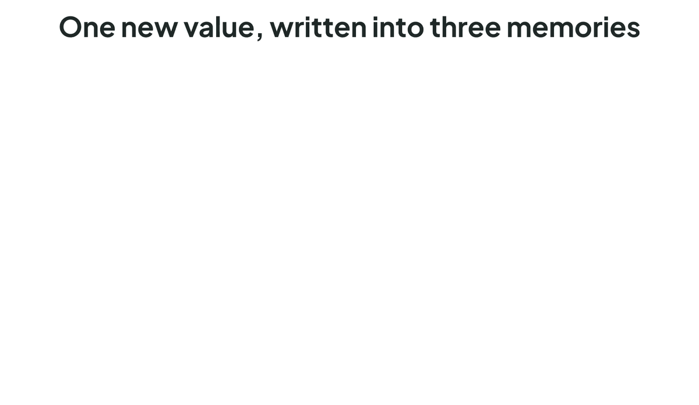

# KronLSTM

[](https://arxiv.org/abs/2610.26834)
[](LICENSE)

Triton kernels and a PyTorch layer for KronLSTM, from the paper *Kronecker Delta Rule for Long Context Linear Attention* ([arXiv:2610.26834](https://arxiv.org/abs/2610.26834)).

<p align="center">
  
</p>

KronLSTM is a linear-attention recurrence whose matrix state $\mathbf{S}\in\mathbb{R}^{K\times V}$ is written along one rank-one Kronecker key $\mathbf{k}_t\mathbf{v}_t^\top$ per step. A scalar write strength closes the residual between what the state already stores for the pair and a target:

```math
\begin{aligned}
y_t &= \mathbf{k}_t^\top \mathbf{D}_t\mathbf{S}_{t-1}\mathbf{v}_t, & \mathbf{D}_t &= \mathrm{Diag}(e^{\mathbf{g}_t}) \\
u_t &= \beta^*_t\,(c_t\lVert\mathbf{v}_t\rVert^2 - y_t), & \beta^*_t &= s\,\beta_t/\lVert\mathbf{v}_t\rVert^2 \\
\mathbf{S}_t &= \mathbf{D}_t\mathbf{S}_{t-1} + u_t\,\mathbf{k}_t\mathbf{v}_t^\top, & \mathbf{o}_t &= \text{scale}\cdot\mathbf{q}_t^\top\mathbf{S}_t
\end{aligned}
```

with a unit-norm key and query, an erase gate $\beta_t\in[0,1]$, a write (target) gate $c_t\in[0,1]$, $s=2$ under `allow_neg_eigval` and $s=1$ otherwise, and a decay $\mathbf{g}_t\le 0$ per key dimension or per head. On $\mathrm{vec}(\mathbf{S})$ this is the gated delta rule with key $\mathrm{vec}(\mathbf{k}_t\mathbf{v}_t^\top)$, so training uses the chunkwise WY/UT form of GDN-2 and KDA without ever forming the $KV$-dimensional keys. `decouple_erase`, on by default in the layer, takes $\beta_t$ off the write so that it gates the erase only; the [kernel README](fla/ops/kronlstm/README.md) contains this and the other variants, the chunkwise derivation, the kernel list and the numerics.

## Contents

This repository is a snapshot of [FLA](https://github.com/fla-org/flash-linear-attention) at [`78a39922`](https://github.com/fla-org/flash-linear-attention/commit/78a39922d56562336e22e5a429b039f34ef2bf7f) with KronLSTM added in FLA's layout. Everything else is FLA as of that commit. KronLSTM is intended to be integrated to FLA in the future.

| Path | Contents |
| --- | --- |
| [`fla/ops/kronlstm/`](fla/ops/kronlstm/) | `chunk_kronlstm` (training: chunkwise forward and backward), `fused_recurrent_kronlstm` (inference: token-by-token forward), and the naive PyTorch references |
| [`fla/layers/kronlstm.py`](fla/layers/kronlstm.py) | the `KronLSTM` token-mixing layer |
| [`fla/models/kronlstm/`](fla/models/kronlstm/) | `KronLSTMConfig`, `KronLSTMModel` and `KronLSTMForCausalLM`: the paper's language model, optionally with sliding-window attention layers |
| [`tests/ops/test_kronlstm.py`](tests/ops/test_kronlstm.py), [`tests/layers/test_kronlstm_layer.py`](tests/layers/test_kronlstm_layer.py), [`tests/models/test_modeling_kronlstm.py`](tests/models/test_modeling_kronlstm.py) | tests of the kernels against the references, of the layer, and of the model |
| [`benchmarks/ops/registry.py`](benchmarks/ops/registry.py) | `chunk_kronlstm` and `fused_recurrent_kronlstm` in FLA's benchmark runner |

## Pretrained models

The paper's language models, each trained on 100B tokens with the Llama-2 tokenizer, are on the Hugging Face Hub:

| Model | Layers | Context |
| --- | --- | --- |
| [KronLSTM-1.5B-100B](https://huggingface.co/NX-AI/KronLSTM-1.5B-100B) | 24 KronLSTM | 8K |
| [KronLSTM-1.5B-100B-32k](https://huggingface.co/NX-AI/KronLSTM-1.5B-100B-32k) | 24 KronLSTM | 32K |
| [KronLSTM-SWA-1.5B-100B](https://huggingface.co/NX-AI/KronLSTM-SWA-1.5B-100B) | 20 KronLSTM + 4 sliding-window attention (window 2048, no positional encoding) | 8K |
| [KronLSTM-SWA-1.5B-100B-32k](https://huggingface.co/NX-AI/KronLSTM-SWA-1.5B-100B-32k) | 20 KronLSTM + 4 sliding-window attention (window 2048, no positional encoding) | 32K |

The 8K models are trained on FineWeb-Edu. The 32K models branch from the 8K runs after 75B tokens and train the remaining 25B at 32K context on a long-document mixture from ProLong-64k.

## Installation

```sh
git clone https://github.com/NX-AI/KronLSTM.git
cd KronLSTM
pip install -e ".[cuda]"
```

The package keeps FLA's distribution name, `flash-linear-attention`, and its import name, `fla`, so it replaces any FLA installed in the same environment. [INSTALL.md](INSTALL.md) covers FLA's other install routes.

Models with attention layers, such as the hybrid pretrained models, also need [FlashAttention](https://github.com/Dao-AILab/flash-attention), which FLA's attention layer runs on:

```sh
pip install flash-attn --no-build-isolation
```

KronLSTM was developed and tested on NVIDIA Hopper (H100) and Ampere (A100) GPUs with PyTorch 2.13 and Triton 3.7.1 (the CUDA 13.0 build of PyTorch on H100, the CUDA 12.6 build on A100). Other GPUs and backends are untested.

## Usage

A pretrained model, through transformers' Auto classes, which `import fla` registers KronLSTM with:

```python
import torch
from transformers import AutoModelForCausalLM, AutoTokenizer

import fla  # noqa: F401

tokenizer = AutoTokenizer.from_pretrained('NX-AI/KronLSTM-1.5B-100B')
model = AutoModelForCausalLM.from_pretrained('NX-AI/KronLSTM-1.5B-100B', dtype=torch.bfloat16).cuda().eval()
```

A new model: `KronLSTMConfig()` is the paper's 1.5B configuration (24 layers, hidden size 2048, 16 heads of dimension 128), and `KronLSTMForCausalLM(config)` initialises it as the paper's models were initialised. `attn` places softmax attention at chosen layers, as in FLA's other hybrid models; the paper's hybrids use

```python
from fla.models import KronLSTMConfig, KronLSTMForCausalLM

config = KronLSTMConfig(attn={'layers': [5, 11, 17, 23], 'num_heads': 16, 'window_size': 2049, 'use_rope': False})
model = KronLSTMForCausalLM(config)
```

`use_rope=False` is KronLSTM's addition to FLA's attention specification: attention without positional encoding. `window_size` counts the attending token itself, so 2049 attends to the token and the 2048 before it.

The layer:

```python
import torch
from fla.layers import KronLSTM

layer = KronLSTM(hidden_size=1024, k_head_dim=128, v_head_dim=128, num_k_heads=8, num_v_heads=8)
layer = layer.to(device='cuda', dtype=torch.bfloat16)
x = torch.randn(2, 2048, 1024, device='cuda', dtype=torch.bfloat16, requires_grad=True)
o, _, _ = layer(x)
o.sum().backward()
```

The projections keep `nn.Linear`'s default init. A framework that applies its own init should call `layer.reset_gate_parameters()` afterwards: it re-initialises the parameters whose init is the layer's own (the decay's `A_log` and `dt_bias`, and the output gate's bias and weights). `A_log`, `dt_bias`, every bias and the norm weights are marked `_no_weight_decay`. The layer also takes a `[B, T]` padding `attention_mask`, packed `cu_seqlens`, and FLA's cache for decoding; see its docstring.

The op:

```python
import torch
import torch.nn.functional as F
from fla.ops.kronlstm import chunk_kronlstm

B, T, H, K, V = 2, 2048, 8, 128, 128
q = F.normalize(torch.randn(B, T, H, K, device='cuda'), dim=-1).to(torch.bfloat16)
k = F.normalize(torch.randn(B, T, H, K, device='cuda'), dim=-1).to(torch.bfloat16)
v = F.normalize(torch.randn(B, T, H, V, device='cuda'), dim=-1).to(torch.bfloat16)
beta = torch.rand(B, T, H, device='cuda', dtype=torch.bfloat16)
g = F.logsigmoid(torch.randn(B, T, H, K, device='cuda'))
o, final_state = chunk_kronlstm(q, k, v, g, beta, output_final_state=True, decouple_erase=False)
```

`fused_recurrent_kronlstm` takes the same arguments and runs the forward only, for decoding. Both ops take variable-length inputs packed along `T` with batch size 1 and `cu_seqlens`, as the other FLA ops do.

## Tests and benchmarks

```sh
pytest tests/ops/test_kronlstm.py tests/layers/test_kronlstm_layer.py tests/models/test_modeling_kronlstm.py
python -m benchmarks.ops.run --op chunk_kronlstm chunk_kda chunk_gdn2
```

Each test shape compiles every autotuning config of the kernels, so the first run with an empty Triton cache takes about an hour on one H100. Later runs reuse the cache.

## Limitations

- `chunk_kronlstm` needs head dims $K, V$ in $[16, 256]$, and runs at a fixed chunk length of 64; `fused_recurrent_kronlstm` needs $K, V\le 256$.
- With fp32 inputs, `chunk_kronlstm` needs $K\le 128$ or $V\le 128$. The layer passes q, k and v in its projections' dtype, so under bf16 autocast it runs the bf16 kernels at any supported head dims.
- No context parallelism and no grouped value attention (`num_v_heads` must equal `num_k_heads`).

## Citation

If you use KronLSTM, please cite the paper, and FLA, which the kernels are built on:

```bib
@article{hartl2026kronlstm,
  title   = {Kronecker Delta Rule for Long Context Linear Attention},
  author  = {Hartl, Anamaria-Roberta and Z{\'o}lyomi, Levente and List, Michael and Klambauer, G{\"u}nter and B{\"o}ck, Sebastian and Hochreiter, Sepp},
  journal = {arXiv preprint arXiv:2610.26834},
  year    = {2026}
}

@software{yang2024fla,
  title  = {FLA: A Triton-Based Library for Hardware-Efficient Implementations of Linear Attention Mechanism},
  author = {Yang, Songlin and Zhang, Yu},
  url    = {https://github.com/fla-org/flash-linear-attention},
  month  = jan,
  year   = {2024}
}
```

## License

MIT, as FLA; see [LICENSE](LICENSE).
